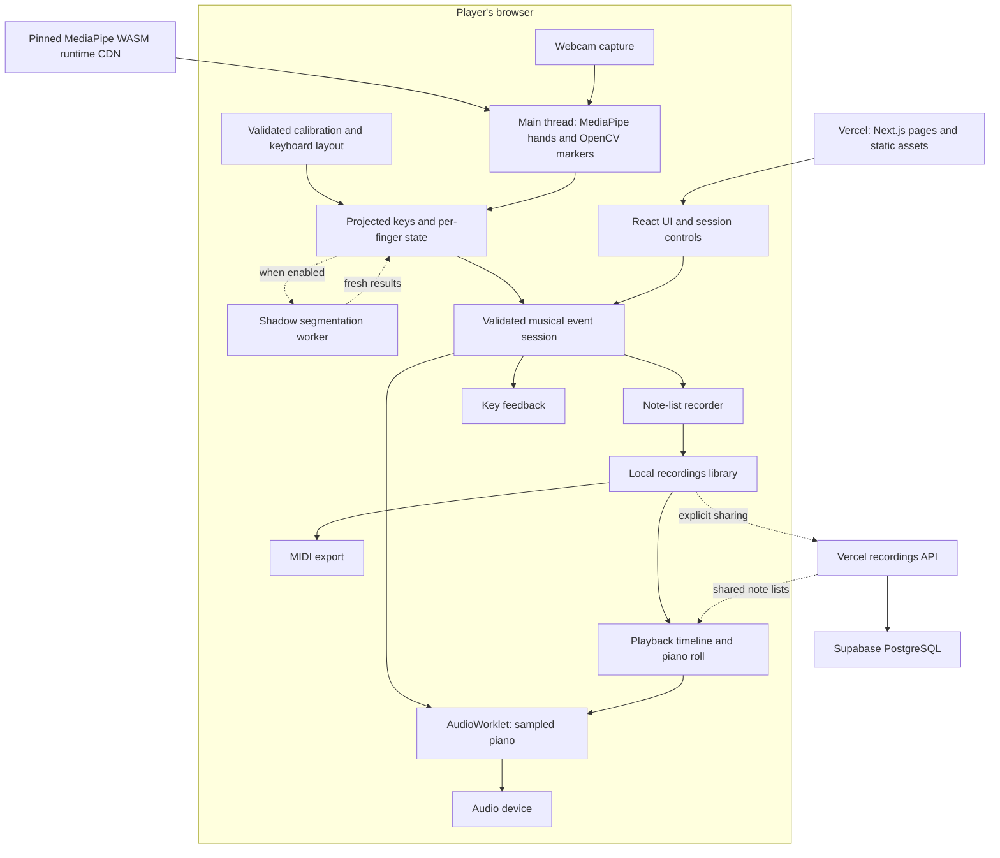
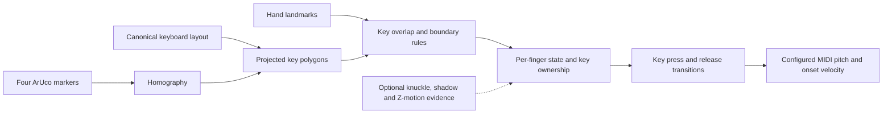
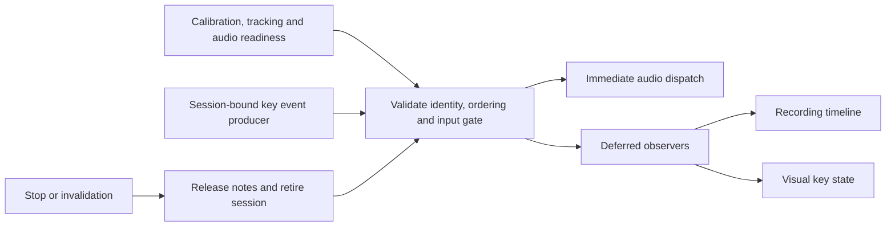

# Explanation MakeShift

## System Overview

MakeShift lets people play a printed piano keyboard using a webcam and a
browser. It tracks their hands, maps finger positions to keys, and sends note
events to audio, recording, and visual feedback. Players can use one to three
octaves, control loudness through finger movement, use pedals, and save,
replay, export, or share recordings.

The original goal still guides the project: make piano playing accessible
without a physical instrument. Paper keeps the setup simple and inexpensive,
though it cannot reproduce a piano's key travel or feel.

Live playing runs on the user's device. Vercel serves the application and
assets; Supabase stores recordings that users choose to share. Neither handles
individual notes, so a database outage does not stop local playing once the
application has loaded.

Some parts are still prototypes. Hand inference and marker detection run on
the main thread, and the default uses finger overlap to trigger keys. Reliable
touch detection and moving the full CV pipeline into a worker remain unfinished.
See the [browser architecture](architecture.md) for the broader plan.

## Architecture Diagrams

The [original design document](Design%20Document.pdf) placed CV and audio in a
Python/JavaScript backend connected through WebRTC. The updated diagram puts
both in the browser and adds optional recording storage. Dashed arrows show
optional paths.

Detection has two jobs: identify the key under a finger and determine whether
the finger touched it. The first is implemented; the second still needs work.

Accepted notes go to audio first. Recording and feedback follow without
holding up sound dispatch.

## Key Components

### Camera, calibration, and geometry

MediaPipe tracks up to two hands, while OpenCV.js detects four ArUco markers
on the sheet. The markers define a homography that projects the keyboard into
the camera image. Detection and drawing use the same projected keys, keeping
the overlay aligned with the regions that trigger notes.

The layout defines octave count, starting C, paper coverage, and pitch mapping.
It stays separate from camera projection so the same layout works across camera
angles. Boundary rules help fingers retain their current key near an edge.
Printable extensions preserve key spacing as the range grows; playing beyond
the declared paper coverage requires an explicit override. See the
[sheet and layout contract](piano_sheet.md).

[Calibration](calibration.md) saves a versioned record of the camera, frame
dimensions, markers, layout, and hand references. Guided captures also produce
per-hand depth models. Camera or layout changes can invalidate these records,
so compatibility checks release active notes and require recovery. Failed
storage writes are reported to the player.

### Contact detection and velocity

The contact controller tracks each finger's key, recent movement, and press
state. It includes three optional checks: knuckle position limits the playing
zone, shadow analysis looks for contact evidence, and Z-motion prediction can
start a note while waiting for shadow confirmation.

All three are disabled in the default
[configuration](../frontend/src/cv/liveContactPipeline.ts). Overlap can therefore
trigger a note while a finger hovers. The
[contact state machine](contact_state_machine.md) describes the experimental
combined path, but its descriptions of enabled defaults are outdated.

Velocity comes from recent finger speed relative to the wrist and palm size.
It is fixed when a note starts and passed to audio and recording. This gives
players some loudness control, but measures motion rather than pressure.

### Events and sessions

The [shared event format](note_events.md) connects detection to audio, MIDI,
and feedback. Events include a version, session ID, sequence, timestamp, pitch,
and press ID; note-on events also include velocity. These fields let consumers
reject old input and match releases to the right presses.

The live producer combines fingers by key rather than emitting a separate
note for every finger on the same key. The event and audio layers can still
represent separate presses at the same pitch.

Playing requires compatible calibration, fresh tracking, a visible page, and
ready audio. Interruptions, invalid ordering, or overload clear held notes.
Restarting creates a new session ID so delayed callbacks cannot revive old
notes. Audio receives accepted events before MIDI and feedback, without waiting
for React to render. Observation, delivery, audio, and recording times stay
separate so processing delays do not rewrite when a note was observed.

### Audio and pedals

A user gesture enables the [browser audio engine](browser_audio.md). It loads
19 stereo Salamander piano samples and decodes them before accepting notes.
The AudioWorklet transposes nearby samples, applies velocity and register
balance, and mixes the result. Fetching and decoding happen at startup, never
during a note.

Ten preallocated voices keep rendering work bounded. When all are occupied,
the oldest voice is replaced. Press IDs prevent a late release from stopping
its replacement. Sustain, sostenuto, and soft pedals use the same ordered
transport; keyboard and UI controls combine into a binary pedal state.

The C++/PortAudio engine remains a native reference that plays on its host
machine. The website uses the AudioWorklet, while the procedural browser synth
is retained for comparison.

### Recording, playback, and storage

The recorder stores note lists with pitch, velocity, timing, tempo, and meter.
Pausing closes recorded notes and excludes paused time. Live playing can
continue during a recording pause and after recording Stop.

Start and resume count-ins silence piano notes and pedals while tracking
continues. Held keys need a release and fresh press after the count-in. Clicks
use the audio clock independently of the display. BPM means quarter notes per
minute; each count-in beat follows the selected
[meter's denominator](meter.md).

The [local library](recordings_library.md) saves validated note lists in browser
storage. `midi-writer-js` creates MIDI files on demand, keeping file generation
and storage writes out of the note path. A failed save leaves the take in
memory for download or retry, with its unsaved status shown.

Local and shared playback use the same audio engine with pause, seek, and rate
controls. The piano roll follows the playback timeline. Main-thread timers
still schedule playback, so heavy work or background throttling can delay it.
DAW support currently means importing exported MIDI files; live MIDI output
is not implemented.

### Sharing and diagnostics

Sharing sends recording data through Next.js API routes to
[Supabase](supabase.md). Client and server share validation rules, and database
credentials stay on the server. Users receive a deletion token; the database
stores its hash. This supports anonymous sharing without accounts, but losing
the token means losing that deletion authority.

Lists use keyset pagination and load full notes only for selected recordings.
Upload sizes are limited. Rate limiting is unfinished, so uploads on Vercel
require an explicit opt-in. Sharing failures do not affect local playing.

[Diagnostics](performance.md) collect bounded timing and resource data, while
labeled video replay helps compare detection changes. These tools expose
software delays; physical press-to-sound measurements also need a press
reference and captured audio output.

## Design Decisions

### What changed from the original design

The original document compared hosting, MIDI, CV, and audio alternatives using
weighted scores. Those scores recorded expectations, not benchmark results.
The priorities still apply, but several choices changed as live processing
moved into the browser.

| Original choice or proposal | Current approach |
| :--- | :--- |
| Next.js, React, TypeScript, Tailwind, and MediaStream | Retained for the interface, styling, and camera capture. |
| MediaPipe with a possible PyTorch fallback | MediaPipe and OpenCV.js; no trained PyTorch fallback. |
| Python backend on Render with WebRTC | Local CV/audio, with Vercel hosting and recording APIs. Python remains in native bindings and tools. |
| Web Audio, Tone.js, and `@tonejs/midi` | Web Audio with a custom AudioWorklet and `midi-writer-js`. |
| SPSC queue for MIDI | Validated browser events; an SPSC queue exists separately in native audio. |
| Proposed Selenium browser tests | Playwright, alongside Vitest, TypeScript, lint, and contrast checks. Python and native suites remain separate. |

### Hosting and framework

The original study favored Render over Railway and Vercel because the proposed
WebRTC backend needed a persistent process. Predictable billing favored Render
over Railway. Local processing removed that requirement: Vercel now serves
assets and request-based APIs, with no server round trip for each note.

Next.js keeps routed views and server endpoints in one project. React manages
the interface, while TypeScript helps keep subsystem contracts consistent.
Runtime validation still checks stored data, messages, and uploads. Work that
affects note timing stays outside React renders.

### MIDI transport

The MIDI study preferred a lock-free SPSC ring buffer (MIDI-2) over a
mutex-protected FIFO (MIDI-1) or moving coordinate calculations into MIDI
(MIDI-3). The goal was to reduce overhead and leave resources for CV.

The browser keeps MIDI lightweight through deferred event consumers. CV decides
contact, pitch, and velocity once; audio and MIDI use those results. This avoids
duplicate detection logic. The native
[SPSC queue](../backend/src/audio/SpscQueue.h) carries audio hits and is separate
from browser MIDI recording.

### Computer vision

The original CV alternatives were tracking moving keys (DA-1), changing camera
placement (DA-2), and training a PyTorch model (DA-3). Moving-key detection would
require more than flat paper, while custom training would add substantial data
and validation work. The study preferred DA-2 among the alternatives but left
its accuracy untested.

The current approach keeps a single camera and pretrained hand tracker.
Markers handle perspective; contact detection remains a separate problem.
Camera placement still needs evaluation. The proposed folded sheet edges were
not adopted, and MediaPipe Z does not establish fingertip distance from paper.

### Audio preparation and rendering

The audio study favored caching backend-generated notes in the frontend
(AUDIO-1) over generating everything locally (AUDIO-2) or receiving finished
audio from the backend (AUDIO-3).

The current engine keeps the useful part of AUDIO-1: prepare sound before
playing. It preloads static recordings, then renders locally. Changing keyboard
range does not request new backend-generated notes. This avoids network jitter
during performance but adds startup decoding and memory use.

JavaScript AudioWorklet processing is sufficient for the current voice pool.
A WebAssembly port would need a measured benefit to justify extra build and
integration work. Neither approach removes camera or audio-device buffering.

## Tradeoffs and Limitations

Touch accuracy and response time remain the main challenge. Overlap is quick
but cannot distinguish hovering from touching. More confirmation and hysteresis
may reduce false notes while delaying short presses or releases. Lighting,
occlusion, posture, camera angle, and motion blur affect the available evidence.

Caching geometry reduces marker-detection work. After acquisition, scans run
every ten seconds; missed scans retain the last usable projection. Sheet
movement or removal can go unnoticed between checks, and a visible overlay
does not guarantee compatible calibration.

Local processing spreads the live workload across users' devices, but each
device must handle CV alongside the interface. The hand loop skips unchanged
frames, and optional shadow work is bounded. Moving the full CV pipeline into
a worker remains planned.

Ten voices limit audio cost but can cut off notes when pedals retain long
tails. Sparse samples reduce downloads but lose realism when heavily transposed.
Pedals are binary, without half-pedaling or sympathetic resonance;
[pedal recording and export](pedal_recording_followup.md) remain deferred.

Browser storage can fill up, be blocked, or be cleared. Unsaved takes disappear
on navigation. Sharing still needs rate limiting, and mobile and cross-browser
support require further verification.

The related work below separates open follow-ups from limits already discussed
in completed issues. A closed issue does not mean every tradeoff was removed.

| Limitation | Related work |
| :--- | :--- |
| Hovering can trigger notes | [#142](https://github.com/Kakrl/MakeShift/issues/142), open |
| CV still runs on the main thread | [#37](https://github.com/Kakrl/MakeShift/issues/37), open |
| Playback timers can be delayed by load or backgrounding | [#258](https://github.com/Kakrl/MakeShift/issues/258), new verification follow-up to #130 |
| Cached geometry can hide sheet movement between scans | [#220](https://github.com/Kakrl/MakeShift/issues/220), closed; documents the retained scan policy |
| Ten voices, sample transposition, and binary pedal realism | [#26](https://github.com/Kakrl/MakeShift/issues/26), [#210](https://github.com/Kakrl/MakeShift/issues/210), and [#176](https://github.com/Kakrl/MakeShift/issues/176), closed; accepted limits or deferred extensions |
| Pedals are missing from recording/export | [#222](https://github.com/Kakrl/MakeShift/issues/222), open |
| Browser storage limits and compatibility coverage | [#124](https://github.com/Kakrl/MakeShift/issues/124), [#114](https://github.com/Kakrl/MakeShift/issues/114), and [#89](https://github.com/Kakrl/MakeShift/issues/89), closed; mobile remains outside the current target |
| Upload abuse protection | [#129](https://github.com/Kakrl/MakeShift/issues/129), open |
