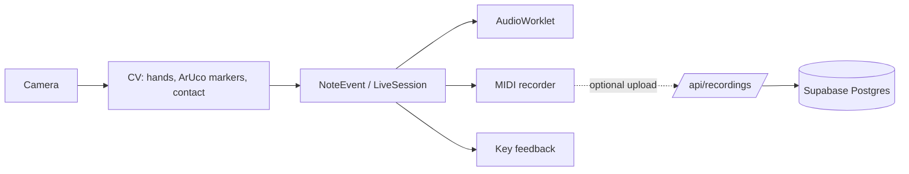

# Reference MakeShift

Lookup reference for developers working on MakeShift, a browser piano played
on a printed keyboard sheet through a webcam. If this page and the code
disagree, the source wins! For how the system works, see
[`docs/architecture.md`](architecture.md).

- [System Structure](#system-structure)
- [Key APIs / Interfaces](#key-apis--interfaces)
- [Configuration](#configuration)
- [DB Schemas](#db-schemas)
- [Keyboard Layout and Pitch Mapping](#keyboard-layout-and-pitch-mapping)
- [Calibration](#calibration)
- [Pedals](#pedals)
- [Velocity and Timing](#velocity-and-timing)
- [Browser Storage](#browser-storage)
- [Scripts and Tests](#scripts-and-tests)

---

## System Structure

### Pipeline



Only things related to sharing songs touch the internet.

| Stage | Runs in |
| :--- | :--- |
| Camera capture, hand tracking, marker detection | Main thread |
| Shadow segmentation | Web Worker ([`shadowWorker.ts`](../frontend/src/cv/shadowWorker.ts)) |
| Note session dispatch | Main thread |
| Sound | AudioWorklet ([`frontend/public/audio/`](../frontend/public/audio)) |
| MIDI recording and export | Main thread, after audio |
| Shared recordings | Next.js route handlers on Vercel, backed by Supabase |

File locations: [repository map in `AGENTS.md`](../AGENTS.md#repository-map).

### Routes

| Route | Page |
| :--- | :--- |
| `/` | Main play screen: camera, overlays, recording, pedals |
| `/calibration` | Sheet and hand calibration |
| `/audio` | Sound check |
| `/tutorial` | Tutorial |
| `/documentation` | In-app docs |
| `/about` | About |
| `/cv-video-replay` | Runs recorded video through the CV pipeline (testing) |
| `/play/[id]` | Opens a shared recording |

### Stack

Major versions only. Exact versions are in
[`frontend/package.json`](../frontend/package.json) and the lockfile.

| Area | Tool |
| :--- | :--- |
| App | Next.js 16, React 19 |
| Hand tracking | `@mediapipe/tasks-vision` 0.10 |
| Marker detection | `@techstark/opencv-js` 5 |
| MIDI files | `midi-writer-js` 3 |
| Tests | Vitest 4, Playwright, `selenium-webdriver` 4 |
| Database | Supabase Postgres 17 |
| Native engine | C++23, CMake 3.15+, PortAudio, nanobind, Python 3.12 |

---

## Key APIs / Interfaces

### Note Events

This is the format every note producer (CV, a worker, a test) sends to the session.

Source: [`events/noteEvents.ts`](../frontend/src/events/noteEvents.ts).
Semantics: [`docs/note_events.md`](note_events.md).

```ts
type NoteEvent = Readonly<{
  version: 1;
  sessionId: string;   // 1-128 chars
  sequence: number;    // positive safe integer, +1 per event
  timestampMs: number; // finite, >= 0, relative to main performance.timeOrigin
} & (
  | { type: "note-on";  pressId: number; pitch: number; velocity: number }
  | { type: "note-off"; pressId: number; pitch: number }
  | { type: "release-all" }
)>;
```

| Field | Rule |
| :--- | :--- |
| `pitch` | Integer MIDI, 0–127 |
| `velocity` | Finite, `0 < velocity ≤ 1` |
| `pressId` | Positive safe integer; each `note-on` must be higher than the last in the session |
| `note-off` | Must name a held press with the same pitch |

| Function | Signature | Returns |
| :--- | :--- | :--- |
| `parseNoteEvent` | `(value: unknown)` | Frozen `NoteEvent`, or `null` |
| `toMainTime` | `(timestampMs, sourceOriginMs, mainOriginMs)` | Main-clock ms; throws `RangeError` on bad input |
| `toRecordingMilliseconds` | `(eventMs, startMs, excludedPausedMs = 0)` | `max(0, eventMs - startMs - excludedPausedMs)` |
| `AudioClock.resume` | `(mainMs, audioSeconds)` | Links a main-thread time to an audio time |
| `AudioClock.suspend` | `()` | Drops that link (audio suspended) |
| `AudioClock.toSeconds` | `(eventMs, currentAudioSeconds)` | AudioContext seconds; throws while suspended |

#### What happens to an event

Every event gets one of these results (`DispatchResult` from `NoteSession.receive`,
[`events/noteSession.ts`](../frontend/src/events/noteSession.ts)).

| Result | Why | Ends session? |
| :--- | :--- | :--- |
| `accepted` | Valid, in order, audio took it | No |
| `stale` | For a session that isn't current | No |
| `duplicate` | `sequence` at or below the last accepted | No |
| `invalid` | Rejected by `parseNoteEvent` or clock conversion | Yes |
| `interrupted` | Stream broke (see below) | Yes |

Causes of `interrupted`:

- Gap in `sequence`
- Time going backwards or into the future
- `pressId` not increasing
- 128 notes held at once
- Mismatched `note-off`
- Audio refused the event
- 256 deliveries stuck waiting for note listeners

Every consumer gets a final `release-all` when a session ends.

---

### LiveSession

This decides whether notes from the camera are allowed to play. Notes can only go
through while it's `playing`.

Source: [`events/liveSession.ts`](../frontend/src/events/liveSession.ts).

| State | Meaning |
| :--- | :--- |
| `stopped` | No session (initial state) |
| `starting` | Audio starting up |
| `ready` | Calibration, tracking and audio all good; `play()` works |
| `playing` | Session open, taking notes |
| `interrupted` | Lost readiness, layout changed, or audio invalidated |
| `error` | Audio failed to start |

Tracking older than 500 ms (`TRACKING_TIMEOUT_MS`) counts as stale.

| Method | Signature | Notes |
| :--- | :--- | :--- |
| `constructor` | `(audio: BrowserAudio, now?)` | Allocates nothing, so it's safe to create early |
| `attach` | `() => () => void` | Call in an effect; returns cleanup |
| `subscribe` | `(listener) => unsubscribe` | State changes |
| `subscribeNotes` | `(listener: (d: Delivery) => void) => unsubscribe` | Accepted events, after audio |
| `status` | `LiveStatus` getter | `{ state, message, canStart }` |
| `sessionId` | `string \| null` getter | Current note session |
| `layout` | `KeyboardLayout` getter | Layout captured at session start |
| `play` | `() => string \| null` | Opens a session from `ready`; returns its ID |
| `noteOn` | `(sessionId, pressId, pitch, velocity, timestampMs?)` | Returns `DispatchResult` |
| `noteOff` | `(sessionId, pressId, pitch, timestampMs?)` | Returns `DispatchResult` |
| `receive` | `(value: unknown, clock?)` | Raw `NoteEvent`; don't mix with `noteOn`/`noteOff` |
| `setHidden` | `(hidden: boolean)` | Page visibility |
| `stop` | `()` | Ends session → `stopped` |
| `interrupt` | `(message: string)` | Ends session → `interrupted` |
| `observeCalibration`, `observeUncalibratedSheet`, `observeTracking`, `trackingFailed` | | CV inputs that move it in and out of `ready` |

#### Key event producer

This turns each frame's pressed and released keys into `noteOn`/`noteOff` calls.

Source: [`events/keyEventProducer.ts`](../frontend/src/events/keyEventProducer.ts).

```ts
type KeyPress = { keyIndex: number; velocity: number };
const produce = createKeyEventProducer(session: LiveSession, sessionId: string);
produce(pressed: KeyPress[], released: number[], timestampMs: number);
```

- `keyIndex` counts white keys first, then black keys
  ([mapping](#key-index--midi)).
- Releases run before presses.
- Calls are ignored once its `sessionId` isn't current.

---

### BrowserAudio

Singleton `browserAudio`. The only owner of an AudioContext.

Source: [`app/audio/audioEngine.ts`](../frontend/src/app/audio/audioEngine.ts).
Background: [`docs/browser_audio.md`](browser_audio.md).

| Method | Signature | Notes |
| :--- | :--- | :--- |
| `status` | `"idle" \| "loading" \| "ready" \| "suspended" \| "error"` | |
| `initialize` | `() => Promise<void>` | Call from a user gesture; loads samples |
| `noteOn` | `(note: number, velocity = 0.8) => { session, press } \| null` | `note` 0–127, `0 < velocity ≤ 1` |
| `noteOff` | `(token: { session, press }) => boolean` | Releases only that press |
| `releaseAll` | `() => boolean` | |
| `setPedals` | `({ sustain, sostenuto, soft }) => boolean` | |
| `subscribeInvalidation` | `(listener) => unsubscribe` | Fires when audio resets or recovers |
| `close` | `() => Promise<void>` | Frees the context and samples |

| Property | Value |
| :--- | :--- |
| Voices | 10 stereo, allocated up front |
| Samples | 19 Salamander grand piano, preloaded |
| Bass boost | +6 dB |
| Latency hint | `"interactive"` |

---

### Recordings REST API

Upload, list, open and delete shared recordings. Everything is under `/api`,
returns JSON and sends `Cache-Control: no-store`.

Handlers: [`server/recordings.ts`](../frontend/src/server/recordings.ts).
Types: [`lib/recordings.ts`](../frontend/src/lib/recordings.ts).

| Method | Path | Body | Returns |
| :--- | :--- | :--- | :--- |
| `GET` | `/api/health` | | `200` `{ database: DatabaseHealth }` |
| `GET` | `/api/recordings?cursor=` | | `200` `RecordingListResponse` |
| `POST` | `/api/recordings` | `UploadRecordingRequest` | `201` `UploadRecordingResponse` |
| `GET` | `/api/recordings/:id` | | `200` `SharedRecording` |
| `DELETE` | `/api/recordings/:id` | `DeleteRecordingRequest` | `200` `{ deleted: true }` |

```ts
type RecordedNote = {
  pitch: string;      // note name, e.g. "C4", "F#3", "Bb2"
  velocity: number;   // integer 1-100
  startMs: number;    // ms from recording start
  durationMs: number; // how long the note is held
};

type RecordingSummary = {
  id: string;         // UUID
  title: string;
  authorName: string;
  bpm: number;        // used for MIDI export
  durationMs: number; // computed by the server
  noteCount: number;  // computed by the server
  createdAt: string;  // ISO timestamp
};

type SharedRecording        = RecordingSummary & { notes: RecordedNote[] };
type RecordingListResponse  = { recordings: RecordingSummary[]; nextCursor: string | null };
type UploadRecordingRequest = { title: string; authorName: string; deviceId: string; bpm: number; notes: RecordedNote[] };
type UploadRecordingResponse = { id: string; deleteToken: string };
type DeleteRecordingRequest  = { deleteToken: string };
type RecordingApiError = { error: string; issues?: { field: string; message: string }[] };

type DatabaseHealth =
  | { status: "ok"; latencyMs: number }
  | { status: "unconfigured" }
  | { status: "error"; httpStatus?: number };
```

#### Upload limits

From `RECORDING_LIMITS`. Lengths count Unicode code points.

| Field | Rule |
| :--- | :--- |
| `title` | Trimmed, 1–100 characters |
| `authorName` | Trimmed, 1–50 characters |
| `deviceId` | Trimmed, 1–128 characters |
| `bpm` | Integer, 20–400 |
| `notes` | 1–10,000 notes |
| `notes[i].pitch` | Matches `^([A-G])([#b]?)(-?\d+)$`, MIDI 0–127 |
| `notes[i].velocity` | Integer, 1–100 |
| `notes[i].startMs` | 0 to 1,800,000 (30 min) |
| `notes[i].durationMs` | At least 0; `startMs + durationMs` can't pass 1,800,000 |
| Whole body | Up to 1,000,000 bytes (`MAX_UPLOAD_BYTES`) |

- Only the first bad note shows up in `issues`.
- Extra fields on a note are dropped.
- The server computes `durationMs` and `noteCount`, so don't send them.

#### Pagination

| Property | Value |
| :--- | :--- |
| Page size | 6 (`RECORDING_LIST_PAGE_SIZE`) |
| Order | Newest first (`created_at desc, id desc`) |
| Hidden rows | Left out |
| Next page | Pass `nextCursor` back as `?cursor=` |
| Last page | `nextCursor` is `null` |
| Cursor format | base64url JSON of the last row's `[created_at, id]` |

#### Delete tokens

| Property | Value |
| :--- | :--- |
| Format | 32 random bytes, base64url |
| Returned | Once, in the `POST` response |
| Stored | SHA-256 hex hash only (`delete_token_hash`) |
| Accepted length | 1–256 characters |

A lost token can't be recovered, so that recording can't be deleted through
the API.

#### Errors

| Status | `error` | When |
| :--- | :--- | :--- |
| `400` | `Invalid cursor.` | Cursor doesn't decode |
| `400` | `Body must be JSON.` | Body doesn't parse |
| `400` | `Invalid recording.` | Validation failed; see `issues` |
| `403` | `A valid delete token is required.` | Token missing, malformed or wrong |
| `404` | `Recording not found.` | ID isn't a UUID, or row is hidden or deleted |
| `413` | `Recording is too large.` | Body over 1,000,000 bytes |
| `502` | `The recordings database could not be reached.` | Supabase failed or took over 8 s |
| `503` | `Shared recordings are not configured.` | `SUPABASE_URL` or `SUPABASE_SECRET_KEY` missing |
| `503` | `Sharing is not open yet.` | Upload on Vercel without `RECORDING_UPLOADS=1` |

`/api/health` returns `503` whenever `database.status` isn't `"ok"`. Its
Supabase check times out after 5 s.

---

### Native Audio Engine (C++, Python bindings)

C++ engine exposed to Python as the nanobind module `audio_engine`.

Source: [`backend/src/Bindings.cpp`](../backend/src/Bindings.cpp).

| Method | Signature | Notes |
| :--- | :--- | :--- |
| `AudioEngine` | `AudioEngine(voice_limit=AudioEngine.MaxVoices)` | |
| `initialize` | `()` | Opens PortAudio |
| `start_stream` | `()` | |
| `stop_stream` | `()` | |
| `submit_hit` | `(note: int, velocity: float) -> bool` | `note` 0–127, `0 < velocity ≤ 1`; one producer thread only; `False` on bad input or full queue |

Each hit is a 100 ms decaying sine at 44.1 kHz, up to 10 voices. No note-off.

---

## Configuration

### Environment variables

Template: [`frontend/.env.example`](../frontend/.env.example). Real values are
in Infisical, project `makeshift` ([setup](supabase.md)).

| Variable | Scope | Default | Effect |
| :--- | :--- | :--- | :--- |
| `SUPABASE_URL` | Server | unset | Supabase project URL. Unset → recordings API `503`, health `unconfigured` |
| `SUPABASE_SECRET_KEY` | Server | unset | Bypasses RLS. Never expose to client code |
| `RECORDING_UPLOADS` | Server | `0` | Set to `1` to allow uploads on any Vercel deployment |
| `VERCEL_ENV` | Server | set by Vercel | `production` or `preview`; turns on the upload gate |
| `NEXT_PUBLIC_VERCEL_ENV` | Client | set by Vercel | `production` disables `?dev=1` |
| `NEXT_PUBLIC_PIPELINE_DIAGNOSTICS` | Client, build time | `0` | `1` shows the performance panel; needs a rebuild |
| `NEXT_PUBLIC_BUILD_COMMIT` | Client, build time | `""` | Commit shown in diagnostics |

Local run with secrets:

```sh
cd frontend
infisical run --env=dev -- npm run dev
```

### URL parameters

| Parameter | Effect | Works in |
| :--- | :--- | :--- |
| `?dev=1` | Skips saved calibration; live marker geometry alone decides if you can play | Local and preview, not production |
| `?mock=1` (or any value) | Shared recordings UI loads sample songs instead of the API | All builds |
| `?mock=empty` | Empty list | All builds |
| `?mock=error` | Error state | All builds |

### Debug flags

In [`frontend/src/debugFlags.ts`](../frontend/src/debugFlags.ts). Change and
rebuild.

| Flag | Default | Effect |
| :--- | :--- | :--- |
| `pipelineDiagnostics` | from `NEXT_PUBLIC_PIPELINE_DIAGNOSTICS` | Performance panel |
| `visualDebug` | `false` | CV debug overlays |
| `showZLines` | `true` | Depth calibration lines |
| `showSheetWithoutCalibration` | `true` | Draws the sheet before calibration |
| `landmarkersTestGather` | `false` | Logs calibration hand landmarks to the console |

---

## DB Schemas

Supabase Postgres 17, project `makeshift`.

Migration: [`supabase/migrations/20260930000000_create_recordings.sql`](../supabase/migrations/20260930000000_create_recordings.sql).
Apply with `npx supabase db push --linked`.

### `public.recordings`

| Column | Type | Nullable | Default | Constraint |
| :--- | :--- | :--- | :--- | :--- |
| `id` | `uuid` | no | `gen_random_uuid()` | Primary key |
| `title` | `text` | no | | `char_length` 1–100 |
| `author_name` | `text` | no | | `char_length` 1–50 |
| `device_id` | `text` | no | | `char_length` 1–128 |
| `bpm` | `integer` | no | | 20–400 |
| `duration_ms` | `integer` | no | | ≥ 0 |
| `note_count` | `integer` | no | | ≥ 0 |
| `notes` | `jsonb` | no | | Array (`jsonb_typeof = 'array'`) of `RecordedNote` |
| `delete_token_hash` | `text` | no | | SHA-256 hex of the delete token |
| `hidden` | `boolean` | no | `false` | Hidden rows never come back from reads |
| `created_at` | `timestamptz` | no | `now()` | |

### Indexes

| Name | Columns | Condition |
| :--- | :--- | :--- |
| `recordings_pkey` | `id` | |
| `recordings_visible_created_at_idx` | `created_at desc` | `where not hidden` |
| `recordings_device_id_idx` | `device_id` | |

### Access

| Role | Access |
| :--- | :--- |
| `anon`, `authenticated` | None. All privileges revoked; RLS on with no policies |
| Service role (`SUPABASE_SECRET_KEY`) | Full. Only `frontend/src/server/` uses it |

### API ↔ column mapping

API fields are the camelCase column names (`author_name` → `authorName`).
Exceptions:

| API field | Column |
| :--- | :--- |
| `deviceId` | `device_id`; never returned by reads |
| `deleteToken` | `delete_token_hash`; only the hash is stored |

---

## Keyboard Layout and Pitch Mapping

Source: [`cv/keyboardLayout.ts`](../frontend/src/cv/keyboardLayout.ts),
[`cv/noteMap.ts`](../frontend/src/cv/noteMap.ts).
Printed sheet: [`docs/piano_sheet.md`](piano_sheet.md).

### `KeyboardLayout`

```ts
interface KeyboardLayout {
  octaves: number;            // 1, 2 or 3
  startingMidi: number;       // multiple of 12 (a C)
  whiteKeys: number;          // 7 * octaves + 1
  paperOctaves?: number;      // 1, 2 or 3; how much the printed sheet covers
  paperFitOverride?: boolean; // allow a layout wider than the paper
}
```

| Rule | Value |
| :--- | :--- |
| Default | `{ octaves: 1, startingMidi: 48, whiteKeys: 8 }` (C3–C4) |
| Valid | `startingMidi + 12 * octaves ≤ 127` |
| Usable | Valid, and `octaves ≤ paperOctaves` or `paperFitOverride` |
| On change | Clears saved and depth calibration; interrupts the live session |

### Sheet dimensions

| Constant | Value |
| :--- | :--- |
| `WHITE_KEY_PITCH_MM` | 23.5 mm |
| `OCTAVE_SPAN_MM` | 164.5 mm |
| `keyboardWidthMm(octaves)` | `(7 * octaves + 1) * 23.5` mm |
| `MARKER_INSET_MM` | ~8.545 mm |
| Sheet ID | `aruco-0-3-white-keys-v1` (ArUco markers 0–3) |

### Key index → MIDI

All white keys first, then all black keys.

| Indexes | Key | Formula |
| :--- | :--- | :--- |
| `0` to `whiteKeys - 1` | White | `startingMidi + 12·⌊i/7⌋ + [0,2,4,5,7,9,11][i % 7]` |
| `whiteKeys` to `whiteKeys + 5·octaves - 1` | Black | `j = i - whiteKeys`; `startingMidi + 12·⌊j/5⌋ + [1,3,6,8,10][j % 5]` |

Default layout (`startingMidi = 48`), white keys:

| Index | 0 | 1 | 2 | 3 | 4 | 5 | 6 | 7 |
| :--- | :-- | :-- | :-- | :-- | :-- | :-- | :-- | :-- |
| Note | C3 | D3 | E3 | F3 | G3 | A3 | B3 | C4 |
| MIDI | 48 | 50 | 52 | 53 | 55 | 57 | 59 | 60 |

Black keys:

| Index | 8 | 9 | 10 | 11 | 12 |
| :--- | :-- | :-- | :-- | :-- | :-- |
| Note | C#3 | D#3 | F#3 | G#3 | A#3 |
| MIDI | 49 | 51 | 54 | 56 | 58 |

### Functions

| Function | Signature | Returns |
| :--- | :--- | :--- |
| `keyIndexToMidi` | `(keyIndex, layout?)` | White-key MIDI, or `null` |
| `blackKeyIndexToMidi` | `(blackKeyIndex, layout?)` | Black-key MIDI, or `null` |
| `pianoKeyIndexToMidi` | `(keyIndex, layout?)` | Either, by region index, or `null` |
| `midiToPitch` | `(midi)` | Sharp name, e.g. `60 → "C4"`, `61 → "C#4"` |
| `pitchToMidi` | `(pitch)` | MIDI, or `null`; takes `#` or `b` |
| `startingNotes` | `(octaves)` | Every valid `startingMidi` for that many octaves |
| `validLayout` | `(value: unknown)` | Type guard, `value is KeyboardLayout` |
| `usableLayout` | `(layout)` | `boolean` |
| `sameLayout` | `(a, b)` | `boolean` |

---

## Calibration

As of now, calibration maps the printed sheet into camera pixels and records a resting
hand reference for contact detection.

Source: [`cv/calibration.ts`](../frontend/src/cv/calibration.ts).
Details: [`docs/calibration.md`](calibration.md).

### `CalibrationResult`

```ts
interface CalibrationResult {
  version: 1;
  coordinates: "unmirrored-frame-pixels/marker-unit-square";
  sheet: "aruco-0-3-white-keys-v1";    // which printed sheet
  camera: { deviceId: string; width: number; height: number; facingMode: string };
  layout: KeyboardLayout;              // layout at calibration time
  corners: { x: number; y: number }[]; // the 4 sheet corners, in frame pixels
  contact: {
    model: "landmark-reference-v1";
    hover?: { x: number; y: number; z: number }[][]; // legacy, unused
    rest: { x: number; y: number; z: number }[][];   // resting hand landmarks
  };
}
```

Saved under `makeshift.calibration.v1`. Depth calibration lines are saved
separately under `depthCalibrationLines`
([`cv/depthCalibration.ts`](../frontend/src/cv/depthCalibration.ts)).

### Reuse checks

`compatibleCalibration` reuses a saved calibration only if every check passes.
Otherwise you recalibrate.

| Check | Rule |
| :--- | :--- |
| Shape | Passes `validateCalibration` |
| Sheet | Same `sheet` ID |
| Camera | Same `deviceId`, `width`, `height`, `facingMode` |
| Layout | `sameLayout` as current, and still usable |
| Corners | Each within 1% of the frame diagonal of the live marker corners |

### What clears it

| Action | Effect |
| :--- | :--- |
| Changing the keyboard layout | Clears saved and depth calibration; interrupts the live session |
| Switching camera or resolution | Fails the camera check; recalibrate |
| Moving the sheet | Fails the corner check once markers drift past 1% |
| `?dev=1` | Ignores saved calibration for that page load |

---

## Pedals

Pedals are bound to keyboard keys and sent to audio with
`browserAudio.setPedals({ sustain, sostenuto, soft })`.

Source: [`app/PedalControls.tsx`](../frontend/src/app/PedalControls.tsx).
Saved under `makeshift:pedal-bindings:v1`.

| Field | Values |
| :--- | :--- |
| Pedal | `sustain`, `sostenuto`, `soft`, `none` |
| `code` | `""`, `KeyA`–`KeyZ`, `Digit0`–`Digit9`, `Numpad0`–`Numpad9` |
| `mode` | `hold` (down while held), `toggle` (press to flip) |

Each key can be bound to only one pedal.

---

## Velocity and Timing

Velocity and time use different units depending on where a note is.

### Velocity scales

| Where | Range | Conversion |
| :--- | :--- | :--- |
| `NoteEvent`, `BrowserAudio`, native engine | `0 < v ≤ 1` | |
| `RecordedNote`, recordings API | Integer 1–100 | `max(1, round(v * 100))` |
| MIDI export | 128 PPQ | `ticks = round(ms * 128 * bpm / 60000)` |

### Clocks

| Clock | Unit | Origin |
| :--- | :--- | :--- |
| `NoteEvent.timestampMs` | ms | Main thread `performance.timeOrigin` |
| Worker or other source | ms | Its own origin; convert with `toMainTime` |
| AudioContext | seconds | Converted by `AudioClock.toSeconds` (throws while suspended) |
| `RecordedNote.startMs` | ms | Recording start, minus paused time (`toRecordingMilliseconds`) |

### Timeouts and intervals

| Constant | Value | Used for |
| :--- | :--- | :--- |
| `TRACKING_TIMEOUT_MS` | 500 ms | Tracking older than this isn't fresh |
| `MARKER_ACQUIRE_INTERVAL_MS` | 250 ms | Marker search while not found |
| `MARKER_CHECK_INTERVAL_MS` | 10 s | Marker re-check once found |
| Recordings API Supabase timeout | 8 s | Returns `502` past this |
| `/api/health` Supabase timeout | 5 s | |
| Max recording length | 30 min | `startMs + durationMs` ≤ 1,800,000 |

---

## Browser Storage

All client data is in `localStorage`. Helpers:
[`lib/storage.ts`](../frontend/src/lib/storage.ts).

### Key format

`makeshift:<name>:v<version>`

| Part | Rule |
| :--- | :--- |
| `name` | Matches `^[a-z0-9-]+$` |
| `version` | 1 or higher; bumping it drops old data |

| Helper | Signature | Returns |
| :--- | :--- | :--- |
| `storageKey` | `(name, version)` | The key; throws on bad input |
| `readStored` | `(name, version, fallback, validate, storage?)` | Stored value if it validates, else `fallback` |
| `writeStored` | `(name, version, value, storage?)` | `{ ok: true }` or `{ ok: false, reason: "unavailable" \| "quota" \| "error" }` |
| `removeStored` | `(name, version, storage?)` | `boolean` |

### Keys in use

| Key | Holds | Owner |
| :--- | :--- | :--- |
| `makeshift:keyboard-layout:v1` | `KeyboardLayout` | [`lib/keyboardSettings.ts`](../frontend/src/lib/keyboardSettings.ts) |
| `makeshift:playback-settings:v1` | `{ tempo, metronome }` | [`app/page.tsx`](../frontend/src/app/page.tsx) |
| `makeshift:pedal-bindings:v1` | Pedal `Bindings` ([Pedals](#pedals)) | [`app/PedalControls.tsx`](../frontend/src/app/PedalControls.tsx) |
| `makeshift:recordings:v1` | Local recordings library (`Recording[]`) | [`app/midi/recordingsLibrary.ts`](../frontend/src/app/midi/recordingsLibrary.ts) |
| `makeshift:take-shares:v1` | Take ID → `{ id, deleteToken, mock? }`. Clearing it loses delete access | [`app/share/shareStore.ts`](../frontend/src/app/share/shareStore.ts) |
| `makeshift:profile:v1` | Device profile | [`lib/deviceProfile.ts`](../frontend/src/lib/deviceProfile.ts) |
| `makeshift:mock-shared-recordings:v1` | `?mock=` fixtures | [`app/share/mockShareStore.ts`](../frontend/src/app/share/mockShareStore.ts) |
| `makeshift.calibration.v1` (legacy) | `CalibrationResult` ([Calibration](#calibration)); dotted key, skips the helpers | [`cv/calibration.ts`](../frontend/src/cv/calibration.ts) |
| `depthCalibrationLines` (legacy) | Depth calibration lines; unversioned | [`cv/depthCalibration.ts`](../frontend/src/cv/depthCalibration.ts) |

---

## Scripts and Tests

Run from `frontend/`. The full test list and owners are in
[`tests/verification_test_inventory.md`](../tests/verification_test_inventory.md);
how to run every suite (including C++ and Python) is in
[`tests/README.md`](../tests/README.md).

### npm scripts

| Script | Runs |
| :--- | :--- |
| `dev` | `next dev` |
| `build` / `start` | `next build` / `next start` |
| `lint` | ESLint over `frontend/` and `tests/frontend/` |
| `test` | `vitest` |
| `test:contrast` | Color token contrast audit |
| `test:audio-browser` | Browser audio test (`AUDIO_BROWSER_CHANNEL=chromium`) |
| `test:midi-browser` | MIDI export browser test |
| `test:deployment` | Deployment browser test |
| `test:keyboard-layout-browser` | Keyboard layout browser test |
| `test:layout-browser` | Camera layout browser test |
| `test:performance-browser` | Performance metrics browser test |
| `test:cv-video` / `test:cv-video:auto` | CV video replay tests |
| `test:ui-selenium` | Selenium UI navigation checks (`tests/frontend/uiNavigation.selenium.mjs`) |

### Test runners

| Runner | Needs |
| :--- | :--- |
| Vitest | Nothing extra; specs live in `tests/frontend/` |
| Playwright (`*.browser.mjs`) | `npm start` running; `npx playwright install chromium` once |
| Selenium (`*.selenium.mjs`) | `npm start` running; finds or downloads Chrome and chromedriver itself; optional `MAKE_SHIFT_URL` |

### Before a frontend PR

```sh
cd frontend
npm run lint && npx tsc --noEmit && npx vitest run && npm run test:contrast && npm run build
```
